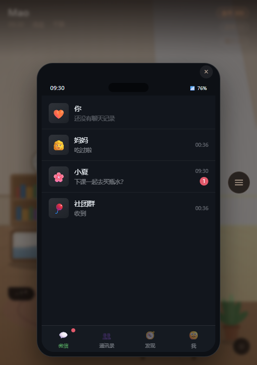
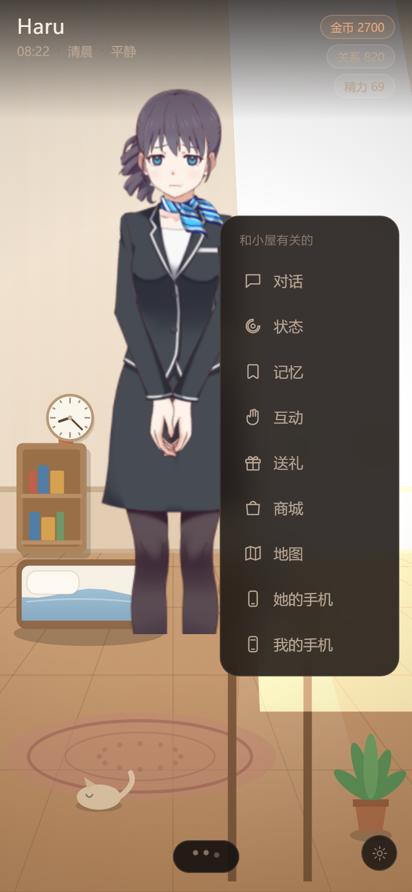

# Eirunest（栖间）

**一个会自己生活的 AI 角色**

TA 有自己的作息、行程和心情。你不在的时候，TA 的日子照样继续——每次回来，都会多出一些你没能参与、却确实发生过的事。

Eirunest 是一个浏览器端可运行的 AI 角色，读音 Eye-roo-nest。TA 拥有自己的时间线、生活轨迹与信息边界：你不打开对话窗口，TA 也在过自己的日子；你想找 TA 的时候，手机上是一个会主动找你、有自己的情绪和作息的人。

三个角色可选，使用 Live2D 呈现——TA 会看着你，也会跟着你的操作做出反应。你自己是男生还是女生、平时怎么被称呼，也都可以自己定。

## 为什么做这个

今天的 AI 陪伴产品大多停在「问答」这件事上：你打开它才存在，你一走它就停在原地。它好像什么都知道，却没有自己的生活；它说的话很像人，但下一句就忘了上一句的温度。

Eirunest 想换个做法——**让 TA 真的在生活**。

## 设计亮点

**TA 有自己的生活。** 什么时候起、今天去哪、在外面待多久，都由 TA 自己的日程决定。你可能打开手机发现 TA 正在咖啡馆，也可能消息发过去半天没回——因为 TA 手上有别的事。

**TA 的视角是有限的。** TA 不是全知的。你发的动态，要等 TA 自己刷到才会看见；要不要回你、隔多久回，也是 TA 自己拿主意。有时候秒回，有时候隔很久，有时候那一轮就没回。

**TA 会变。** 相处久了，TA 和当初不太一样了。这不是写好的剧本，是你们之间发生过的那些事，一点一点把 TA 推成了现在的样子。

**你不在的时候，世界也在走。** 关掉手机，TA 的日子不会暂停。回来时你会先看到这几天 TA 做了什么——一段你没参与、却真实发生过的日子。

## 你能做什么

- **聊天。** 像真人一样收发微信，消息按时间送达、有已读未读，TA 也会在自己想找的时候先发给你。
- **朋友圈和状态。** TA 会发朋友圈、改微信状态；你也可以发自己的，TA 刷到之后可能会点赞、评论。
- **日记和相册。** TA 会写日记、拍照。翻过去，能看到这几天 TA 的心情和去过的地方。
- **知道 TA 在哪。** TA 的一天有安排——上班、上课、出门、回家。你能看到 TA 此刻在哪、正在做什么。
- **打工和金币。** 你可以在这个小镇上打工赚钱，用来买礼物，或者攒着做更长远的事。
- **送 TA 东西。** 礼物会得到真实的反应，TA 有自己的偏好，不会照单全收。
- **真的碰到 TA。** 可以摸头、牵手、靠一会儿。TA 会按当下的心情和你们之间的关系，给出不一样的回应。
- **一起做点什么。** 一起看书、打游戏、做饭、散步。
- **探索这个世界。** 镇上住着不少人——工坊里的女巫阿姨、旧书店的店主、车站的商贩……都可以去认识。往后还会有更多人和地方。

## 自由解谜

除了过日子，这个世界还埋着一些谜题。

线索散在日常里——一句随口的话、一件看着不相干的东西，都可能有用。系统不会替你串联，怎么想、从哪条入手、要不要拉上 TA 一起，全看你自己。

没有标准答案，也不催你。想不通就先放着，过阵子回头看，往往就对上了。

## 界面

| 手机 · 微信 | 小屋里的所有入口 |
|---|---|
|  |  |

## 它是怎么做到的

- **TA 的日常由引擎排，台词由模型写。** 作息、行程、事件、数值和存档由引擎独立控制；模型只负责说话和表达情绪、动作意图，而且要经过校验才会生效——模型不能反过来改 TA 的状态。
- **不接模型也能完整跑。** 没有配置模型服务时，由规则回复兜底，整个流程照常跑通。

## 接下来

1. **更长的记忆**：让一起经历过的事真正沉淀下来，影响 TA 的判断和选择。
2. **更多人和关系**：从单个角色走向多角色、多关系，让小镇真的住着人。
3. **世界自己往前走**：TA 的行动能引发事件，事件改变环境，环境再影响 TA 之后的决定，形成说得清的因果链。
4. **更懂分寸**：让 TA 理解更具体的场合与关系分寸，在不同情境下做出更得体的反应。
5. **更多互动方式**：身体化、多模态、环境式交互。

## 本地运行

```bash
npm install
npm run dev
```

| 命令 | 用途 |
|---|---|
| `npm run dev` | 启动本地开发服务器 |
| `npm run typecheck` | TypeScript 类型检查 |
| `npm run build` | 类型检查并构建生产版本 |
| `npm test` | 运行模型输出安全边界测试 |
| `npm run test:evolution` | 运行人格演化机制的行为测试 |
| `npm run test:ui` | 用独立 headless Chrome 跑端到端 UI 流程并截图 |

技术栈：TypeScript、Vite、PixiJS、Live2D Cubism；存档保存在浏览器本地。默认使用离线回复，需要使用生成模型时，可在应用设置中配置兼容 OpenAI 接口的服务地址、密钥与模型名称。密钥保存在当前浏览器本地；公开部署时应改用服务端代理，不要将密钥写入仓库或客户端构建产物。

## 项目结构

```text
src/
├── core/       状态模型、存档、交互规则、人格演化、时间与世界数据
├── ai/         提示词、记忆检索、模型适配、输出校验与离线回复
├── anim/       角色动画状态与参数映射
├── render/     房间、Live2D 与渲染适配
├── ui/         手机界面、状态面板与交互 HUD
└── game.ts     主循环与模块编排
```

其中 `core/evolution.ts` 是「TA 为什么会变」的集中实现：经历 → 性格倾向 → 以后的行为规则，以及你离开期间发生的事。它不依赖存档与界面，因此可以脱离浏览器单独测试（`npm run test:evolution`）。

## 角色模型与素材

仓库包含 Haru、Mao、Natori 三个 Live2D 官方样例模型。模型来自 `Live2D/CubismWebSamples`，版本固定为 `4-r.7`，以匹配项目使用的 Cubism 4.2 Core。使用或再分发模型素材前，请核对并遵循 [Live2D 免费素材许可协议](https://www.live2d.jp/en/terms/live2d-free-material-license-agreement/)。

## 关于当前版本

- 记忆采用关键词与权重结合的轻量检索，还没有做向量检索与系统评估。
- TA 的自主行为以日程和规则触发为主；你不在期间的推进，是把日程按缺席时段重演出来的，还不是 TA 自己决策产生的事件。
- 性格变化目前体现在若干具体的行为参数上，还没有做过「旁人能不能看出 TA 变了」的验证。
- 对不同场合与分寸的判断目前只做到提示词层面的约束，还没有独立的规范判断模块。
- 身体化交互只覆盖少数部位，也还没有用户研究数据支撑。
- 存档保存在单一浏览器设备中；当前角色和场景数量有限。

以上是这一版的实际状态。研究方向与逐条说明见 [`docs/PROJECT-BRIEF.md`](docs/PROJECT-BRIEF.md)。
