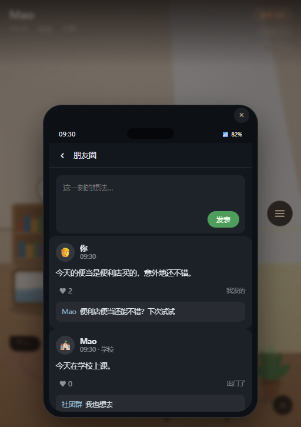
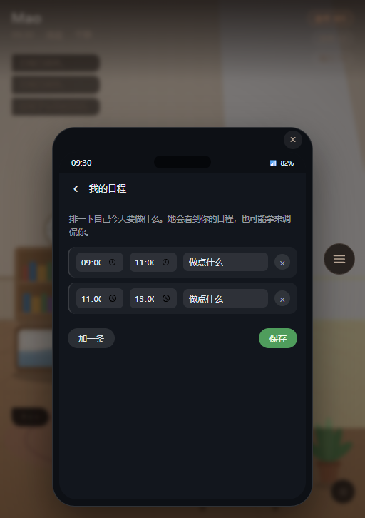
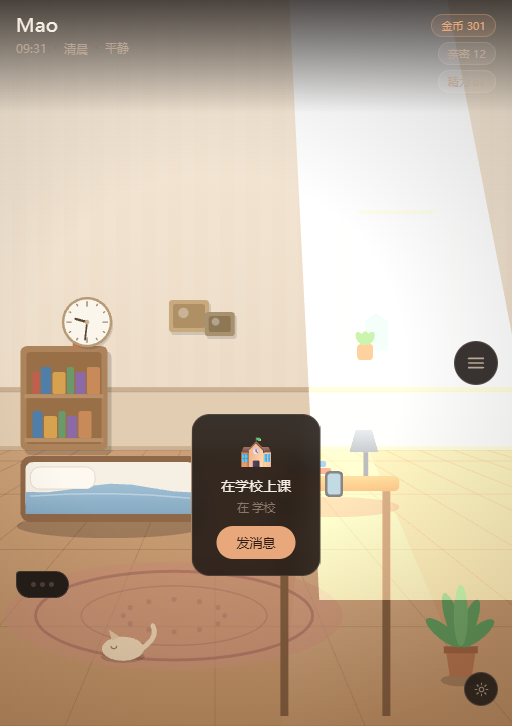

# Eirunest

**面向长期陪伴的生成式 AI 角色与交互叙事研究原型**

Eirunest 是一个浏览器端可运行的交互原型，研究一个具体问题：**当 AI 角色不再是一次性问答的对象，而是一个「一直都在」的陪伴对象时，它需要什么样的内部状态与行为机制，才能让人感到它是活的、是连续的、是在意我的？**

原型以单角色的长期陪伴为核心，把人格倾向、情绪与精力、关系经历、记忆、日常作息、所在位置、以及信息的可见范围，收进同一个持续演化的状态里，并让这些状态反过来影响角色的表达与行动。要验证的不是「模型能不能演出一个性格」，而是**陪伴感能否从机制中生成**——角色有自己的生活、自己的视角、自己的时间，而不是围绕用户的一次输入临时「活过来」。

当前是一个可运行的研究原型，不是已经完成的通用 Agent、文化对齐方案或自主世界模拟系统。

## 设计立场

这几条决定了后面所有机制的取舍：

- **关系被建模为逐渐累积的信任与了解**（原型中体现为「关系进展值」）。所有互动——聊天、送礼、共同活动、身体化交互——都服务于「让角色更像一个持续存在的人」，而不是推进数值以触发结局。
- **角色初始不在用户身边，只能通过手机联系**。她来自另一个世界。「只能隔着屏幕联系」是原型对**共在感缺失（absence of co-presence）**的设计性提问；之后引入的「实体」是用来研究**身体化在场（embodied presence）**如何改变陪伴体验的实验条件。
- **角色的行为由自身状态驱动**，而不是由某一个数值决定。她的保留、迟疑、主动与回避，都来自当下的情绪、精力、戒备心与经历。

原型中的身体化交互（触摸头部、手部等）是**交互形式研究**的一部分——探索非语言、身体化的输入如何影响角色感知与陪伴感。

## 研究动机

本项目来自三个相互关联的问题：

1. **如何设计具有活人感的 AI 角色**：人格不应是提示词里写死的标签，而应像人一样在长期经历中逐渐积累、又随经历持续变化。这引出更进一步的问题——面向「最大程度拟合真实人类」的 Agent，是否需要区别于通用任务型 Agent 的专属建模与训练方式？
2. **文化价值与社会规范如何真正内化为行为逻辑**：不是给角色贴一层文化背景设定，而是让规范成为角色在具体情境中可检索、可权衡、可冲突的决策依据。
3. **可交互世界如何持续演化**：角色的行动应能引发事件、事件改变关系与环境、环境再影响后续决策，形成可追溯的因果链，并使用户离场期间世界仍在推进。

## 界面

| 角色的手机 · 微信 | 我的手机 · 朋友圈 |
|---|---|
|  |  |

| 我的手机 · 日程 | 场景 |
|---|---|
|  |  |

## 当前原型

### 已实现

- **角色状态与交互反馈**：角色拥有情绪、精力、活动、关系进展等显式状态；对话和交互会更新部分状态，状态又参与回应和行为选择。
- **人格倾向的长期演化**：角色另有一组会被经历改写的倾向（表达欲、黏人度、戒备心）。互动与遭遇按类型推动它们，而这些倾向又反过来决定之后的行为规则——主动搭话的概率、害羞阈值、心情衰减速度、出门偏好。因此"被回应得多"与"被冷落得多"的同一个预设，会随相处逐渐长成两个不同的人。倾向的每次变动都留下原因，可回溯。
- **记忆记录与检索**：将互动整理为带时间、类型、权重和标签的记忆，当前使用关键词与时间、重要度加权检索，并注入模型上下文。
- **有限视角与异步社交**：角色不是全知的。她只在自己「刷手机」时才读到用户发布的状态或朋友圈，并依据自身心情与主动性决定是否回应、以什么延迟回应。消息按时间送达，存在已读与未读的区别，模拟真实社交中的非同步节奏。
- **角色自己的时间与行动**：包含作息、日程、地点、主动消息等机制。角色会出门、会写日记、会拍照片。用户离开期间，系统会按缺席时段重演她的日程，把去过的地点补记成真实的照片、朋友圈与记忆，并让这一趟回头影响她的倾向——所以回来时看到的是她留下的痕迹，而不是"她一直在等你"。这仍属于按日程重演，尚未形成完整的自主目标规划与长期因果事件系统。
- **身体化与多模态交互**：集成 Live2D 角色，支持注视跟随、动作反馈，以及触摸不同身体区域、调整环境、通过手机界面查看角色生活痕迹。用于探索不同交互形式对角色感知的影响。
- **阶段式叙事**：通过状态条件触发剧情节点、选择和记忆记录，将预设事件与角色状态连接起来，用于承载「有限视角—被发现—在场」这条体验主线。
- **模型与规则协作**：模型负责生成台词并提出受限的情绪、动作意图；引擎负责数值、存档、状态转换和行为边界。模型输出经过白名单校验，离线时由规则回复兜底。

### 研究计划

以下是后续探索方向，不代表当前系统已经实现：

- 将关键词检索扩展为更稳健的长期记忆组织与检索，并评估记忆如何影响行为一致性。
- 建立结构化的文化价值与社会规范表示，探索情境检索、规范冲突权衡，以及多视角协商机制。
- 扩展角色自主行动和事件因果图，使世界在用户离场期间也能推进，并在用户返回时解释变化的来由。
- 通过用户研究或情境任务，评估不同记忆、状态建模和交互形式对角色一致性、陪伴感与叙事沉浸的影响。

## 技术实现

- **前端与渲染**：TypeScript、Vite、PixiJS、Live2D Cubism
- **角色逻辑**：显式状态模型、确定性状态更新、规则式离线回复
- **生成模型接口**：支持 OpenAI 兼容接口；模型仅产生受限表达与动作意图
- **存储**：浏览器本地存档
- **安全边界**：`src/ai/mapping.ts` 对模型输出做枚举、数值和文本校验；模型不能直接修改游戏状态或存档

## 项目结构

```text
src/
├── core/       状态模型、存档、交互规则、人格演化、时间与世界数据
├── ai/         提示词、记忆检索、模型适配、输出校验与离线回复
├── anim/       角色动画状态与参数映射
├── render/     房间、Live2D 与渲染适配
├── ui/         手机界面、状态面板与交互 HUD
└── game.ts     主循环与模块编排
```

其中 `core/evolution.ts` 是"二阶变化"的集中实现：经历 → 人格倾向 → 以后的行为规则，以及离场期间的事件重演。它只依赖类型与世界数据，不碰存档与界面，因此可以脱离浏览器单独测试（`npm run test:evolution`）。

## 本地运行

```bash
npm install
npm run dev
```

| 命令 | 用途 |
|---|---|
| `npm run dev` | 启动本地开发服务器 |
| `npm run typecheck` | TypeScript 类型检查 |
| `npm run build` | 类型检查并构建生产版本 |
| `npm test` | 运行模型输出安全边界测试 |
| `npm run test:evolution` | 运行人格演化机制的行为测试 |
| `npm run test:ui` | 用独立 headless Chrome 跑端到端 UI 流程并截图 |

默认使用离线回复。需要使用生成模型时，可在应用设置中配置兼容的模型服务地址、密钥和模型名称。密钥保存在当前浏览器本地；公开部署时应改用服务端代理，不要将密钥写入仓库或客户端构建产物。

## 角色模型与素材

仓库包含 Haru、Mao、Natori 三个 Live2D 官方样例模型。模型来自 `Live2D/CubismWebSamples`，版本固定为 `4-r.7`，以匹配项目使用的 Cubism 4.2 Core。使用或再分发模型素材前，请核对并遵循 [Live2D 免费素材许可协议](https://www.live2d.jp/en/terms/live2d-free-material-license-agreement/)。

## 当前限制

- 记忆检索基于关键词和启发式权重，尚未采用向量检索或经过系统评估的记忆压缩方法。
- 角色自主行为以规则、日程和定时触发为主，不具备通用规划能力；离线期间的推进是把日程按缺席时段重演出来的，还不是角色自主决策产生的事件，也没有因果回放。
- 人格倾向的演化目前是"数值漂移 + 改变若干行为参数"，尚未验证它能否形成被外部观察者认可的稳定人格。
- 文化价值与社会规范尚未实现为独立的结构化决策系统；目前只有提示词层面的分层与约束，属于待研究部分。
- 叙事节点目前主要由预设条件触发，尚未实现开放式的多角色协商叙事。
- 身体化交互只覆盖到少数区域，且缺乏用户研究数据支撑其对陪伴感的实际影响。
- 存档保存在单一浏览器设备中；当前角色和场景数量有限。

## 项目简介

### 项目定位

**Eirunest** 是一个面向长期陪伴的生成式 AI 角色研究原型。它尝试把 AI 角色从聊天窗口带入一个可观察、可互动、随时间推进的数字生活空间，探索角色如何依托持续状态与共同经历表现出连贯性与「活人感」，并进一步参与世界变化。当前版本是单角色交互原型；文化规范决策与多角色大世界演化属于后续研究方向。

详细的、与研究方向逐条对应的说明见 [`docs/PROJECT-BRIEF.md`](docs/PROJECT-BRIEF.md)。

### 交互功能亮点

- **非全知角色**：角色有自己的信息边界与查看节奏，只在自身时机读到用户发布的内容，并自主决定是否回应，使互动更接近真人社交而非即时问答。
- **人格可被观察地变化**：状态面板里直接摊开她的表达欲、黏人度、戒备心，以及"最近是什么事让她变了一点"。变化不是靠开发者口头声称，而是可以看着它一天天发生。
- **身体化互动**：通过 Live2D 呈现角色，支持触摸不同身体区域、注视跟随和动作反馈，考察非语言输入对角色感知与陪伴感的影响。
- **角色生活可观察**：角色拥有日常作息、活动地点、日记、相册和朋友圈；用户可以通过仿微信手机界面查看其生活痕迹，并了解角色是否读到自己的消息。
- **异步陪伴体验**：消息按时间送达，用户切换界面时互动仍按游戏时钟推进，用于测试「角色在我不看时也在生活」这一感知。
- **状态驱动的叙事事件**：关系进展、互动和资源条件可以触发阶段剧情，使对话、角色状态与事件解锁发生联系。

### 技术亮点

- **持续角色状态模型**：显式维护情绪、精力、关系进展、活动、日程、记忆与世界时间，避免角色完全依赖单轮提示词呈现人格。
- **二阶演化：经历改写的不是数值，是规则**：互动与遭遇推动人格倾向，倾向再反过来决定主动概率、害羞阈值、心情衰减与行为偏好。数值只是"今天怎样"，倾向决定"她以后会怎么选"，两者分开才有长期人格可言。
- **离场期间的世界推进**：按缺席时段重演角色日程，补记成真实的照片、朋友圈与记忆，并让这一段反过来影响她——"你不在时世界也在推进"因此可查证，而不是一句设定。
- **生成模型与确定性引擎分工**：模型生成台词及受限的情绪、动作意图；引擎校验模型输出，并独立控制数值更新、日程、事件和存档，保证关键状态变化可追踪、可约束。
- **状态—行动—事件闭环**：用户互动、角色日常行为和阶段剧情共享持久化世界状态；事件结果可成为后续生成的上下文，形成原型级的连续互动链路。
- **有限视角与异步消息机制**：区分用户发布内容与角色实际读取内容，并通过排期消息、已读状态和时间推进模拟非同步社交互动。
- **离线可运行与输出安全边界**：无模型服务时使用规则回复；在线模型输出需经过白名单映射，不允许直接操作游戏状态或存档。

当前记忆采用关键词与权重结合的轻量检索，日常行为以规则和预设日程为主。这些是验证整体交互闭环的原型实现，不代表已经解决长期记忆或自主规划问题。

### 未来展望

1. **从记忆到人格发展**：研究如何筛选、组织和重访长期经历，并使记忆持续影响角色的判断、关系处理和行为倾向。当前的演化只覆盖若干可直接观察的行为参数，下一步是让更抽象的人格维度也参与演化，并评估这种演化能否被外部观察者辨认；进一步探讨拟人 Agent 是否需要区别于通用任务 Agent 的建模与训练方式。
2. **文化语境中的角色决策**：将文化价值与社会规范表示为可在具体情境中检索、比较和权衡的决策依据，探索它们如何内化为稳定而非表层的行为逻辑；并尝试多视角协商与针对特定语境的模型对齐。
3. **从单角色到持续演化的大世界**：扩展多角色、地点、关系网络与事件因果机制，使角色依据经历和动机自主行动；行动推动世界变化，世界变化再影响后续角色决策与叙事，并探索用户离场期间的世界持续运行。
4. **交互形式与体验评估**：继续探索身体化、多模态及环境式交互，并通过用户研究评估角色一致性、陪伴感、沉浸感与世界持续感。

以上展望属于研究计划，当前原型尚未实现文化规范驱动的决策系统、多角色自主协商或完整的离线世界模拟。

## GitHub 仓库简介

以「状态—行动—事件」闭环构建长期陪伴的 AI 角色：角色拥有自己的视角与时间，互动在用户离场后仍按世界时钟推进；融合受控生成与身体化交互，探索记忆驱动的人格成长、文化规范决策与多角色因果世界演化。
